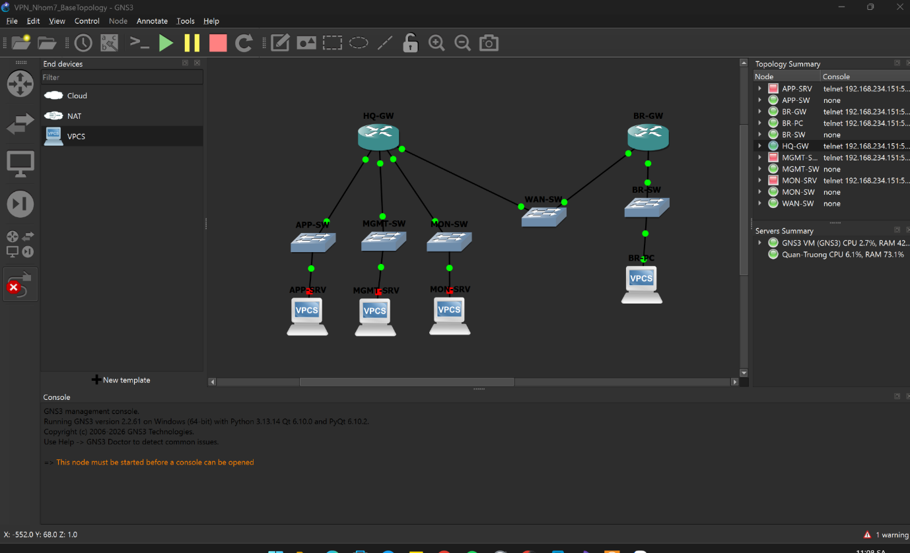

# Hybrid VPN Lab

Enterprise network with an HQ, a Branch office and remote users, built with **Docker Compose** (10 containers, 7 networks).

- **Site-to-Site VPN** HQ ↔ Branch: IPsec IKEv2 (strongSwan), AES-256 / SHA-256 / DH Group 14, certificate authentication, DPD, rekey.
- **Remote Access VPN**: WireGuard gateway with two clients, per-peer revocation.
- **Firewall**: nftables, default-deny, APP / MGMT / MON segmentation.
- **Tester**: Kali node on the WAN for scanning and validation.

## Topology



## IP Plan

| Container | WAN (172.16.0.0/24) | Internal | Role |
|---|---|---|---|
| hq-ipsec | 172.16.0.10 | 192.168.60.1 | HQ IPsec gateway |
| br-ipsec | 172.16.0.20 | 192.168.20.1 | Branch IPsec gateway |
| firewall | 172.16.0.30 | 192.168.60.2, 70.2, 10.1, 40.1, 50.1 | Zone firewall, gateway of APP/MGMT/MON |
| wg-gw | 172.16.0.100 | 192.168.70.1, wg0 10.50.0.1 | WireGuard gateway |
| client-a | 172.16.0.101 | wg0 10.50.0.2 | Remote user |
| client-b | 172.16.0.102 | wg0 10.50.0.3 | Remote user |
| app | — | 192.168.10.10 | Application server |
| mgmt | — | 192.168.40.10 | Management |
| mon | — | 192.168.50.10 | Monitoring |
| kali-tester | 172.16.0.200 | — | WAN tester |

Networks: `app` 192.168.10.0/24 · `branch` 192.168.20.0/24 · `mgmt` 192.168.40.0/24 · `mon` 192.168.50.0/24 · `hq_transit` 192.168.60.0/24 · `wg_transit` 192.168.70.0/24 · WireGuard tunnel 10.50.0.0/24.

## Run

Requires a Linux host with Docker Engine and Docker Compose v2.

```bash
docker compose up -d --build
```

Quick checks:

```bash
docker exec hq-ipsec ipsec statusall              # tunnel ESTABLISHED
docker exec app ping -c 4 192.168.20.1            # HQ -> Branch over IPsec
docker exec client-a ping -c 4 192.168.10.10      # remote user -> APP
docker exec client-a ping -c 2 192.168.40.10      # remote user -> MGMT: blocked
docker exec firewall nft list ruleset             # firewall counters
```

Stop: `docker compose down`

## Structure

```
compose.yaml   docker/ (images)   configs/ (ipsec, pki, wireguard)   evidence/ (test output, pcap)
```

Keys and certificates are lab-only.

**Author:** Đặng Quân Trường
